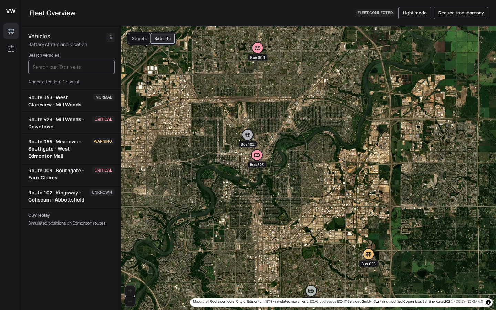

# VoltWatch

VoltWatch is a local fleet-monitoring prototype for exploring battery telemetry from CSV files. It runs a control utility, one monitor process per bus, and a city fleet view. The driver display keeps its main message compact and only opens detailed diagnostics when the bus is marked parked or a demo override is enabled.

**Team:** Arnav Kumar, Jaskaran Singh, Ihsan Aziz, Sahibjot Singh

## Quick start

Requires Python 3.11 or newer. From the repository root, create an environment, install the pinned dependencies, and start the application:

```sh
python3 -m venv .venv
source .venv/bin/activate
python -m pip install -r requirements.txt
python run.py
```

Open the fleet view at [http://127.0.0.1:8200](http://127.0.0.1:8200). The utility controls are at [http://127.0.0.1:8000](http://127.0.0.1:8000); the default five driver displays use ports 8101–8105. Press **Ctrl+C** in the terminal running `run.py` to stop the utility and its owned bus and city processes.

### Command-line options

```text
python run.py [--buses N] [--base-port PORT] [--csv PATH] [--speed N]
```

- `--buses N`: start 1–20 buses (default: 5).
- `--base-port PORT`: utility port (default: 8000). Bus ports start at `PORT + 101`; the city view uses `PORT + 200`.
- `--csv PATH`: use this CSV as the starting scenario for every bus instead of the per-bus built-in demo assignments.
- `--speed N`: set the initial playback speed from greater than 0 through 20 (default: 1×). Faster playback is useful for demos and does not represent real elapsed time.

For example, `python run.py --buses 3 --base-port 9000 --speed 5` starts the utility on port 9000, buses on 9101–9103, and the city view on port 9200.

## What you can explore

- See bus status and labelled simulated Edmonton positions on a fleet map. Selecting a bus opens its module readings, temperature and voltage histories, alert evidence, and data freshness.
- View a compact driver status and module-based charge estimate. Detailed diagnostics are gated by parked state or an explicit diagnostic demo override.
- Assign a supplied CSV independently to each bus, or upload and assign a CSV while the application is running. CSVs are validated before assignment; an unusable upload is rejected.
- Play, pause, step, reset, or change the playback speed for each bus. At 1×, source timestamp gaps set the playback interval, and files loop.
- Inject a temporary critical-temperature reading or missing-sensor event for one module. These events are in memory and do not change the source CSV.
- Stop the utility with Ctrl+C. The utility owns its child processes; a bus process can fail while the other services remain available.

## Architecture and threshold rationale

See [How VoltWatch works](docs/architecture.md) and the [architecture diagram](docs/diagrams/architecture.png) for the service roles and data flow. The [threshold and interface decision table](docs/decisions.md) records each prototype setting, its rationale, and evidence type. It links to the [Molicel P42A datasheet](https://www.molicel.com/wp-content/uploads/INR21700P42A_1.7_Product-Data-Sheet-of-INR-21700-P42A-80092.pdf), [TI BQ76952 reference manual](https://www.ti.com/lit/ug/sluuby2b/sluuby2b.pdf), and [NHTSA driver-interface guidance](https://www.nhtsa.gov/sites/nhtsa.gov/files/documents/812360_humanfactorsdesignguidance.pdf). Those sources inform example design choices; they do not identify or certify the competition battery hardware.

## Limits of the prototype

VoltWatch replays supplied or uploaded CSV measurements; it is not connected to a live battery-management system. The supplied CSVs do not include GPS, so each bus drives back and forth along a real ETS route corridor, and the bus is named after that route. Route geometry comes from the Edmonton Transit Service GTFS feed and contains information licensed under the City of Edmonton Open Data Terms of Use; the vehicle movement itself is simulated. Temperature and voltage thresholds are documented prototype settings, not manufacturer-approved limits for an identified chemistry, pack, or sensor calibration. The charge display is a module-based estimate, and current and health values are diagnostics rather than validated operational limits.

MapLibre, Chart.js and the pinned liquid-glass/React bundle are included locally, so scripts and charts do not need a network connection. Streets uses OpenFreeMap vector tiles and Satellite uses dated EOxCloudless 2024 imagery; basemaps need internet access and retain provider attribution. Satellite is a recorded mosaic, not live imagery. Basemap failures leave fleet details available. The [EOX educational-use license](https://cloudless.eox.at/license-non-commercial) applies to its imagery.

## Tests

Run the test suite from the repository root with the project environment active:

```sh
python -m pytest
```

Run a focused group with, for example, `python -m pytest tests/test_ingest.py tests/test_detection.py`. The integrated macOS run passed 47 tests, including real child-process cleanup, same-port restart, parser failures, recovery, injection provenance and all supplied scenarios. Browser checks cover the live map/drawer, dark-mode persistence, keyboard focus, driver gating, uploads, mobile layout and tile failure. Windows/Linux lifecycle behavior remains unverified.

## Simulation data

Each bus starts at time 0 and reads one CSV row per second, looping at the end of the file. By default the five buses replay the sustained-fault files in `configs/` (normal operation, low voltage, multi-module heating, critical temperature, missing sensor), so every scenario is visible at once; `configs/make_configs.py` rebuilds them from the supplied data. On Simulation Controls, upload any CSV (validated, then stored in `uploads/`), assign it to a bus, or use **Simulate faults** to switch a bus to a config file. Assigning a file restarts that bus at time 0. `--csv PATH` starts every bus on one file instead.

## Presentation

The [presentation](presentation/VoltWatch.pdf) is included as a PDF.

The [design system](DESIGN.md) records the interface decisions. Bus routes are real Edmonton Transit Service corridors from the City of Edmonton Open Data GTFS feed; vehicle movement along them is simulated.


