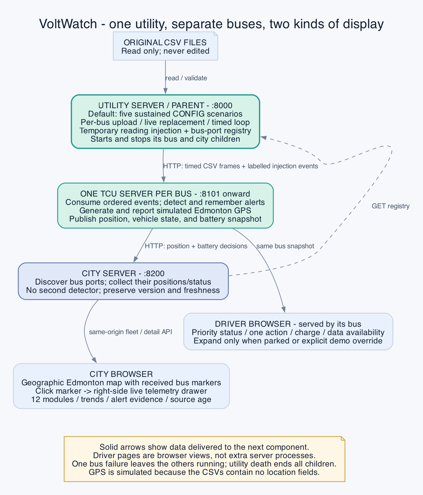
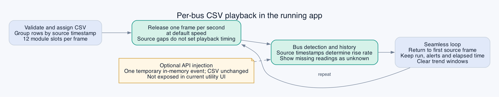

# How VoltWatch works

Implemented prototype, November 21, 2026. Read the [decision table](decisions.md) for the reasons behind thresholds and interface choices.

## One command, three server roles

`python run.py` starts the utility server. It starts one independent server per bus and one city server. Stopping the utility ends its children; a failed bus alone leaves the others running.

| Server | Owns | Browser view |
| --- | --- | --- |
| Utility, :8000 | CSVs, per-bus timing, temporary injected readings, bus-port registry, child processes | CSV upload, per-bus assignment, fault scenarios and parked toggle |
| Each bus, :8101 onward | Battery detection/history and that bus's position | Its driver's compact display and expanded diagnostics |
| City, :8200 | Bus discovery, status collection, map and selected-bus detail | Geographic Edmonton map; clicking a bus opens a live right-side drawer |

The city renders positions reported by bus processes; it does not invent their locations in browser JavaScript. Because the supplied CSVs contain no GPS, the utility assigns each bus a real Edmonton Transit Service route at launch (053 on 50 Street, 523 on 99 Street, 055 on Whitemud Drive, 009 on 97 Street, 102 on 118 Avenue; larger fleets reuse them from a different starting point). The bus is named after its route and drives back and forth along that corridor at 30 km/h, stopping when parked. Full terminal-to-terminal paths are simplified from ETS GTFS shapes in `voltwatch/routes.json`; the timing and movement are simulated, not live vehicle locations. Position includes latitude, longitude, heading, speed, and an observation time. Stale positions remain visibly stale. No City/ETS affiliation is implied.

The city drawer keeps updating the selected bus's twelve module readings, charge/health summaries, temperature/voltage charts, alert evidence, and freshness. Closing it reveals the map again. Marker and fleet-list selection open the same drawer. It uses the locally vendored MapLibre renderer with attributed OpenFreeMap Streets and EOxCloudless 2024 Satellite basemaps. Switching basemaps or themes retains the selected vehicle and highlighted route. Local scripts/charts work without internet; if tiles fail, retain bus coordinates/list and explicitly report that the basemap is unavailable. Do not present a route schematic as the required geographic map.

## CSV playback and temporary events

At default startup, buses receive sustained `configs/CONFIG - ...csv` files in order: Normal operations, Low Voltage, Multiple module heating, Thermal rise and Sensor failure; larger fleets repeat that order. Each bus has an independent cursor. Supplying `--csv` starts every bus with that specified file. Upload a CSV to the utility, then select a bus and assign that file. Validated uploads are saved in `uploads/`; an unusable file is rejected. Assignment switches the selected bus to the beginning without restarting processes.

Rows sharing a source timestamp form a twelve-module frame. The running app releases one frame per second at the default speed, regardless of gaps in the source timestamps. `--speed` changes the initial rate. Source timestamps remain available and are used for temperature-rise calculations. At file wrap the source cursor returns to the beginning while the run, alerts and elapsed display continue; trend windows are cleared at the boundary. This fixed pacing differs from replaying the original timestamp intervals. GPS continues independently.

The utility's **Simulate faults** buttons assign sustained CONFIG files. The backend also supports temporary in-memory injection events; the current utility does not expose per-module injection controls. A bounded delivery journal retains emitted events, with increasing sequence numbers. If a slow consumer falls beyond retention, a gap is reported instead of silently treating the stream as complete.

## Driver attention

| Compact driver view | Expanded diagnostics |
| --- | --- |
| Highest-priority status and one short action | Twelve modules, temperature/voltage trends, raw readings, alert explanation |
| Charge, labelled as a module-based estimate | State of health (SoH), current, individual voltages and coverage details |
| Visible stale/missing-data indicator | Source timestamps and event history |

Expanded diagnostics unlock only when the bus reports parked or the utility explicitly enables a labelled diagnostic demo override. A missing/stale parked state leaves them locked; the driver cannot override this from the page. No automatic expansion, scrolling alert wall, or routine sound/flashing. Color is paired with words/icons. The driver and city consume the same versioned bus decisions. This hierarchy follows [NHTSA's driver-interface guidance](https://www.nhtsa.gov/sites/nhtsa.gov/files/documents/812360_humanfactorsdesignguidance.pdf#page=110), applied as design guidance rather than a claim of regulatory compliance.

Editable diagram sources are the `.dot` files beside each image. With Graphviz installed, regenerate SVG/PNG files using `python3 docs/render_diagrams.py`.
