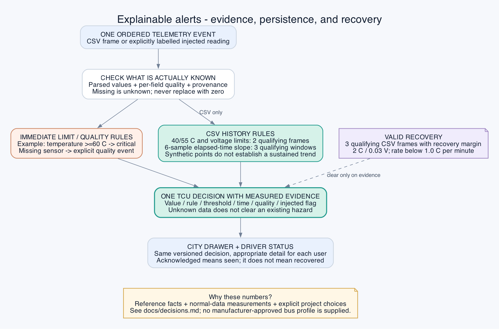

# Why these choices?

These are documented prototype settings, not manufacturer-approved limits for an identified bus. Every new configurable limit must add a value, unit, evidence/reason, and verification case here before implementation.

**Evidence types:** **R** = external reference; **D** = observed supplied data; **E** = explicit engineering choice. Research supports an approach; it does not turn an engineering choice into a universal safety fact.

## Battery rules

The normal CSV spans 26.97–31.66 °C and 3.669–3.691 V. Its largest six-sample temperature rise is 0.656571 °C/min. Reproduce the [saved measurements and candidate-rule probe](baseline-evidence.json) with `python3 docs/check_baseline.py`. This probe checks activation on supplied data; it is not the application detector or complete validation.

For context, the [Molicel P42A datasheet, p.1](https://www.molicel.com/wp-content/uploads/INR21700P42A_1.7_Product-Data-Sheet-of-INR-21700-P42A-80092.pdf) specifies a 3.6 V nominal cell, 4.2 V charging, 2.5 V discharge cutoff, and −40–60 °C discharge operation. The competition does **not** identify that cell, chemistry, pack wiring, or measurement calibration. The reference motivates an illustrative cell-scale profile; it does not establish the supplied module's hardware limits. Its 45 A cell rating must not become a module/pack current limit.

| Choice | Why this value or behavior? |
| --- | --- |
| Temperature warning ≥40 °C | **D/E:** 8.34 °C above the observed normal maximum; a simple early absolute warning alongside rise detection. Not a thermal-runaway threshold. |
| Temperature critical ≥55 °C; ≥60 °C immediate | **R/E:** 55 gives a chosen 5 °C margin before the example's 60 °C discharge ceiling. At 60, omit persistence delay. Actual hardware policy would replace this profile. |
| Rise warning ≥1.5 °C/min | **D/E:** about 2.28× the largest normal six-sample slope. The supplied thermal and multi-module rises exceed it before the absolute warning. |
| Rise critical: ≥50 °C and ≥3 °C/min | **D/E:** combine already elevated temperature with a rise about 4.57× normal's largest slope; avoids calling a cool but changing module critical from rate alone. |
| Fit six consecutive valid CSV samples | **D/E:** spans 50 seconds in these files, smoothing small fluctuations. Use actual elapsed minutes, never a hardcoded ten-second denominator. Gaps reset the window. |
| Absolute alerts: two qualifying CSV frames; rise: three evaluated windows | **R/E:** persistence reduces isolated-spike alerts. At ten-second cadence these span 10 and 20 seconds from first qualifying evidence. The immediate 60 °C rule avoids that delay. |
| Low voltage: warning ≤3.55 V; critical ≤3.35 V | **D/E:** respectively 0.119 and 0.319 V below normal's minimum. These flag the supplied sag well before the example cell's 2.5 V cutoff; they describe prototype anomaly urgency, not physical shutdown limits. |
| High voltage: warning ≥4.15 V; critical >4.20 V | **R/E:** warning precedes the example charging level by 0.05 V; exceeding that reference level merits critical attention. Exactly 4.20 is not a critical crossing. This replaces the earlier unsupported 4.25 V setting. |
| Clear after three valid frames, with 2 °C / 0.03 V recovery margin; rise <1.0 °C/min | **R/D/E:** separate recovery from activation to prevent flicker. The voltage margin exceeds normal's entire 0.022 V span; temperature margin exceeds individual normal-module variation. Exact margins/counts are chosen and tested, not mandated by a source. |
| Group ≥2 thermally warned modules | **E:** two is the smallest multi-module group. Explain simultaneous heating without claiming numbered modules are physical neighbours. |
| Suspected frozen: six CSV frames, spread ≤0.005 °C or ≤0.0005 V | **D/E:** half the supplied export resolution, sustained over the same six-sample window. Require ≥6 valid peers with median spread ≥0.2 °C or ≥0.005 V, chosen to demand meaningful comparison. Stability alone is normal, not proof of sensor failure. |
| Missing/corrupt/non-finite data | **E:** show unknown/quality information immediately, preserve usable channels, never substitute zero. An extreme finite reading stays visible as unverified evidence needing attention; no invented universal sensor-validity range may silently declare it safe. |
| SoC/SoH 0–100%; other channels | **E:** percentage bounds follow their units. Current, SoH and SoC remain reported diagnostics; no chemistry-specific current cutoff, range estimate, or extra operational cutoff is invented. Charge is explicitly a module-based estimate; show coverage. |
| 65 °C injected temperature | **E:** deliberately exceeds the immediate 60 °C demo rule, so one temporary reading really fires an alert. Injection is labelled; it never bypasses detection or writes a source file. |

TI's [BQ76952 reference manual, §§5.2.9–10](https://www.ti.com/lit/ug/sluuby2b/sluuby2b.pdf#page=43) provides examples of configurable protection delays and distinct recovery thresholds. It supports the persistence/hysteresis pattern, not our exact sample counts or limits.

The supplied-data probe finds M03's low-voltage warning at 12:03:40 and critical at 12:05:40; M04–M06 heating warnings at 12:03:30; M07 warning at 12:02:30 and critical at 12:05:00; no hazard activations in Normal operations. Those are regression evidence, not guaranteed unseen-data performance. Application tests also cover frozen sensors, recovery, injection provenance and boundary values.

## Interface and runtime choices

| Choice | Reason and verification |
| --- | --- |
| Highest-priority driver message + one action; parked/demo-only expansion | **R/User/E:** [NHTSA guidance, pp.5-4 and 10-2](https://www.nhtsa.gov/sites/nhtsa.gov/files/documents/812360_humanfactorsdesignguidance.pdf#page=110) supports prioritization and limited visual complexity. User chose a parked-state/explicit-demo gate; stale/unknown state stays locked. Critical information remains visible. This is a design choice, not proof of legal compliance or a passed distraction test. |
| Leaflet 1.9.4; Edmonton geographic map + right drawer | **User/E:** preserves map context while inspecting one bus. The [stable API](https://leafletjs.com/reference-1.9.4.html) supports markers and click events; a CSS drawer needs no extra UI framework. GPS is generated by each bus and labelled simulated. |
| Attributed OSM tiles; local scripts | **R/E:** follow the [tile policy](https://operations.osmfoundation.org/policies/tiles/), retain attribution and normal caching; do not bulk-download tiles for offline use. Basemap failure must be visible; local telemetry still works. |
| 1× timing, automatic loop, per-bus hot swap | **User/E:** preserve source timestamp gaps and keep running. Use the median positive gap at wrap (ten seconds here); a one-frame file needs a one-second fallback to avoid a busy loop. A validated replacement switches atomically and immediately, without waiting for the old file's next frame or restarting processes. |
| Retain 1,000 delivery events and recently closed incidents per bus | **E:** a bounded in-memory journal prevents loop-edge injections disappearing before a poll without growing forever. Reuse the bound for the recent incident log. Sequence numbers keep increasing; run markers reset only active-run state. Test delayed delivery across wrap and explicit overflow gaps. This is a workload bound, not a safety limit. |
| 50 ms playback scheduler; 0.5-second bus/GPS and city polling; two-second browser refresh; 1.5-second polling HTTP timeout | **E:** small local fleet stays visually responsive without processing duplicate source measurements. These are demo responsiveness choices, verified by timeouts/catch-up tests. Freshness expires at three seconds, allowing several poll opportunities without trusting stale driver access. Operator proxy requests allow two to three seconds. `NO SIGNAL` is immediate on failed refresh; `OFFLINE` at thirty seconds is a chosen persistence label. |
| 0–20× playback (zero excluded); at most 256 released events per scheduler tick | **E:** the supported speed cap matches the UI and keeps a small local demo manageable. Dense timestamps are drained in ordered bounded batches with a visible catch-up flag, preserving events while letting HTTP controls run. Test invalid speed rejection and dense playback. |
| Default ports 8000, 8101+, 8200; 1–20 buses | **E:** readable local conventions and a bounded demo workload, not a distributed-scale claim. Verify configured ports and the supported fleet sizes. |
| Ten-second startup; five-second shared shutdown; 0.5-second owner check; three-second child exit grace | **E:** bounded local startup/cleanup; test these deadlines on every OS claimed. [Force kill cannot run a signal handler](https://docs.python.org/3/library/signal.html#signal.SIGKILL), so children also watch their owner. |

Unseen files must not be diagnosed by their name, expected module identity, future samples, or these expected result times. Acknowledging a warning records that it was seen; recovery still requires valid measurements.
